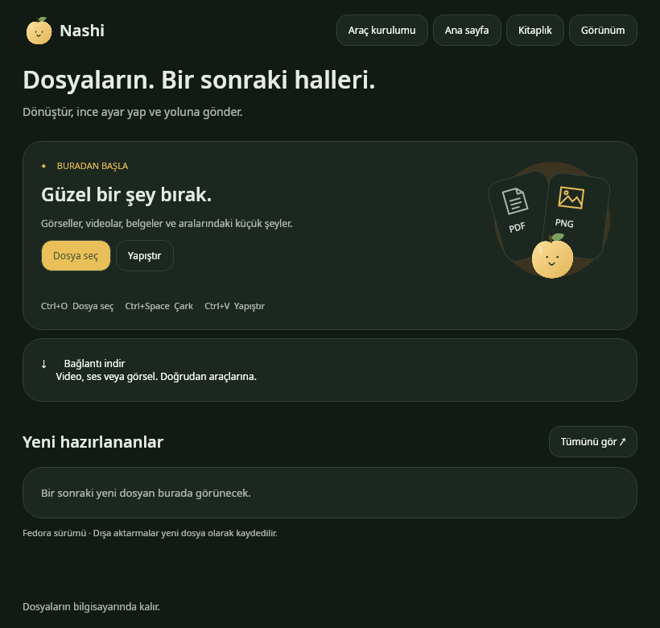

# Nashi · Fedora (deneysel)

**[Fedora 0.1.0 sürümünü indir](https://github.com/yasx01/nashi-app/releases/tag/fedora-v0.1.0)**

Bu, Orkun Işıtmak'ın Nashi projesinin bağımsız Fedora uyarlamasıdır.
Özgün renkler, armut görselleri ve ana ekran düzeni korunur; Linux arayüzü
Avalonia ile yazılır ve mevcut `Nashi.Core` motorunu kullanır.
**Bu ilk sürüm macOS/Windows ile tam özellik eşitliğine sahip değildir.**



## Kurulum

Fedora x86_64 için üretilen RPM dosyasını Yazılım uygulamasıyla açın veya:

```sh
sudo dnf install ./nashi-0.1.0-1.fc44.x86_64.rpm
```

Bu komut uygulamayı ve Fedora depolarındaki sistem bağımlılıklarını kurar.
Uygulama menüsünden Nashi'yi açın. .NET'i ayrıca kurmak gerekmez.
Wayland oturumlarında bu sürüm XWayland kullanır.
Alternatif olarak taşınabilir arşivi bir klasöre çıkarıp `Nashi.Linux` çalıştırın.

## İlk sürümün kapsamı

- Dosya seçimi, pencereye sürükleme, panodaki dosya/metin/bağlantıları alma.
- Özgün tasarıma dayalı ana ekran, araç çarkı, açık/koyu görünüm ve kitaplık.
- Görsel biçim dönüşümleri, PDF oluşturma, boyutlandırma ve sayısal kırpma.
- Fotoğraf parlaklığı, kontrast ve doygunluk ayarları; görsellerden QR okuma.
- Ses/video dönüştürme, kesme, sıkıştırma, ses normalleştirme, ses kaldırma,
  hız değiştirme, birleştirme ve kare alma; mevcut motorun desteklediği seçimlerde.
- PDF birleştirme/ayırma/sıkıştırma, metaveri temizleme ve metin çıkarma.
- Arşiv açma/dönüştürme, SRT/VTT/TXT altyazı dönüşümü.
- Sistem LibreOffice'i üzerinden desteklenen belge, tablo ve sunum dönüşümleri.
- Herkese açık medya bağlantılarını indirme; iptal ve ilerleme bildirimi.
- Özgün dosyaları değiştirmeyen, çakışmada yeni ad üreten dışa aktarma.

Henüz taşınmayanlar: görsel anotasyon/redaksiyon/kolaj ve çerçeve editörleri,
PDF içinden QR okuma, etkileşimli video/PDF düzenleyicileri, Pages dönüşümü ve PDF'nin
görsel yerleşimini koruyan Office dışa aktarmaları,
sistem genelindeki sürükleme/kısayollar, tepsi, pencere yönetimi ve otomatik güncelleme.
Çark, taşınmamış işlemleri çalışıyormuş gibi göstermez. Kırpma ilk sürümde
sayısal alanlarla yapılır; görsel sürükleme editörü henüz yoktur.
Tüm 27 aracın durumu [özellik tablosunda](FEATURES.md) listelenir.

Medya işlemleri için **Araç kurulumu** ekranı eksik araçları upstream'in
SHA-256 denetimleriyle indirir; PATH üzerindeki mevcut araçlar tekrar kullanılır.
Kurulum kullanıcı seçimiyle başlar. Görsel/PDF/altyazı işlemleri için gerekmez.
HEIC çıktısı FFmpeg ister. Platforma özgü kodlayıcı kullanılabilirliği değişebilir.
Kitaplık ve indirilen araçlar kullanıcı veri dizininde tutulur; uygulama kaldırılırken
kişisel veriler otomatik silinmez. Dağıtımda imzalı otomatik güncelleme yoktur.

## Kaynaktan derleme ve kontrol

.NET 10 SDK ve RPM üretimi için `rpm-build` gerekir:

```sh
dotnet restore linux/Nashi.Linux --locked-mode
dotnet build linux/Nashi.Linux -c Release --no-restore
dotnet run --project windows/Nashi.Verify -c Release
dotnet run --project linux/Nashi.Linux -c Release -- --self-test /tmp/nashi-preview.png
bash scripts/build-fedora.sh
```

İlk komut bağımlılıkları indirir; ikincisi derler. İki kontrol komutu ortak motoru
ve Linux dışa aktarma/arayüz akışlarını denetler. Önizleme, ekran açmadan gerçek
Avalonia arayüzünden PNG üretir; bu, Wayland dosya seçicisinin canlı testi değildir.
Son komut `build/fedora` altında bağımsız çalışabilen arşiv, RPM ve sağlama
toplamları üretir. Linux masaüstü etkileşimi ayrıca elle doğrulanmalıdır.

Doğrulama Fedora 44 x86_64 üzerinde yapılır. Testler gerçek FFmpeg ve LibreOffice
çıktılarını, QR içeriğini, PDF birleştirme/ayırmayı, arşiv açmayı, orijinallerin
korunmasını, iptali, kitaplık kısayolunu, açık/koyu görünümü ve çarkı kapsar.
Masaüstü dosya seçicisi, dosya yöneticisinden sürükleme ve gerçek Wayland oturumu
headless testin kapsamı dışındadır. Diğer Fedora sürümleri ve ARM henüz doğrulanmadı.

Lisans ve üçüncü taraf bildirimleri paket içinde korunur.
